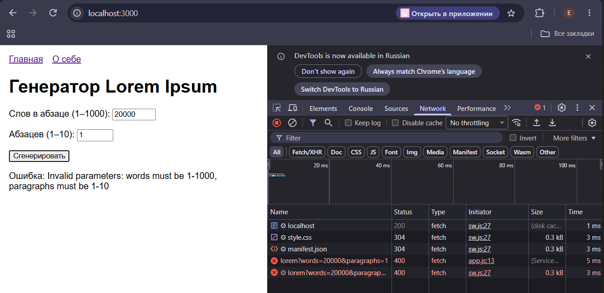
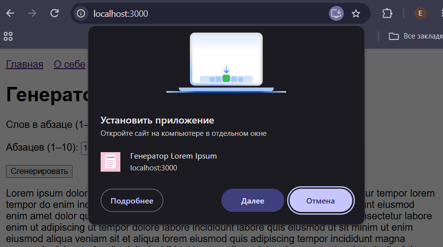
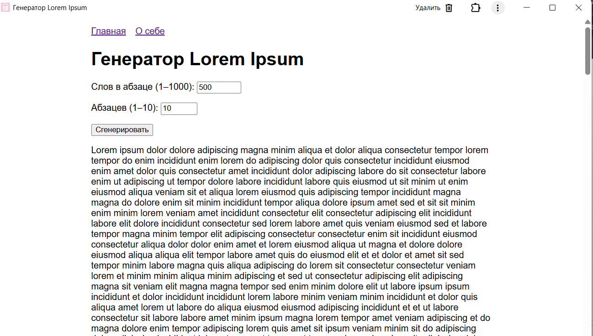

# Лабораторная работа №6- Node.js, Express и PWA

Вариант 19 - Генератор Lorem Ipsum.

Выполнила: Елизавета, группа 932403

Сервер на Express, который отдаёт статические файлы из папки public и генерирует текст Lorem Ipsum. Сайт можно установить как приложение (PWA), он открывается без интернета.

## Запуск

```
npm install
node server.js
```

Потом открыть в браузере http://localhost:3000

## Маршруты

- `/` - главная страница с генератором
- `/about` - страница о себе
- `/api/lorem` - возвращает JSON с текстом

У `/api/lorem` есть два параметра:
- `words` - сколько слов в абзаце (от 1 до 1000, по умолчанию 20)
- `paragraphs` - сколько абзацев (от 1 до 10, по умолчанию 1)

Если передать не целое число или число вне диапазона, сервер вернёт ошибку 400. Например, если ввести 20000 слов:



## Как проверить

На главной странице ввести количество слов и абзацев и нажать «Сгенерировать».

- оставить 20 и 1 - появится один абзац из 20 слов
- ввести 50 и 3 - появятся три абзаца по 50 слов
- ввести 0, -5 или 20000 - появится сообщение об ошибке

Кнопка отправляет запрос на `/api/lorem` с введёнными числами. Его видно в DevTools на вкладке Network: при нормальных числах статус 200, при неправильных 400.

## PWA

В manifest.json указаны название и иконки, он подключён в html. Service worker (sw.js) сохраняет страницы и файлы в кеш, поэтому если выключить сервер, сайт всё равно открывается. Новый текст без сервера сгенерировать не получится.

## Скриншоты




